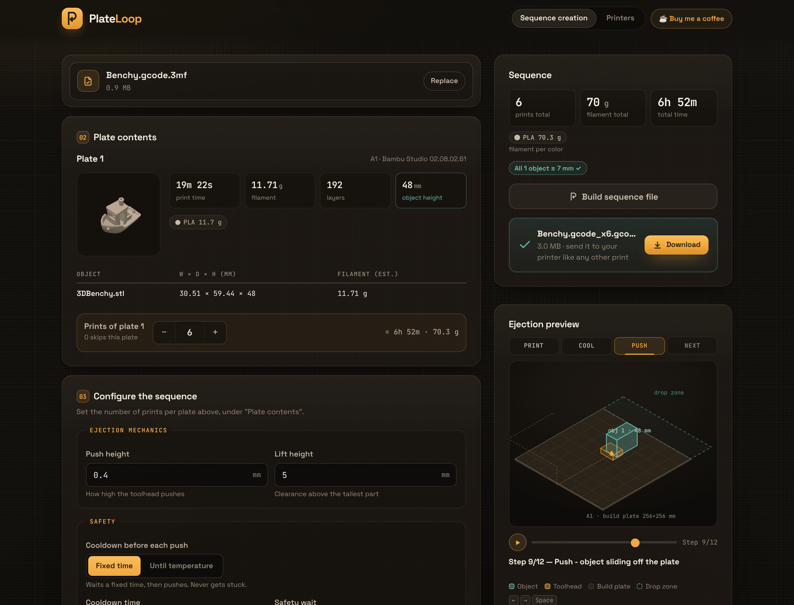

<p align="center"></p>

<h1 align="center">PlateLoop</h1>

<p align="center">
  <b>Print. Eject. Repeat.</b>
</p>

<p align="center">
  <a href="https://github.com/joshmadison/plateloop/actions/workflows/ci.yml"></a>
  <a href="LICENSE"></a>
  
  
</p>

PlateLoop is a self-hosted web app that turns a sliced `.gcode.3mf` (Bambu
Studio or OrcaSlicer) into an **automatic multi-copy print run**: print → cool
→ the printer's own toolhead pushes the part off the plate → re-heat → next
copy. No extra hardware, no account, no cloud.

Push behaviour is **verified on the Bambu Lab A1**. The printer database also
covers Prusa, Creality, Elegoo, Anycubic, QIDI, Sovol and Voron — those models
are honestly marked *needs a test print*.

<p align="center">
  
</p>
<p align="center">
  <sub>A sliced 3DBenchy, six copies: upload once, check the real ejection, download one file for the whole run.</sub>
</p>

## Features

- **One file, many copies.** Set the prints per plate and get a single
  `.gcode.3mf` that runs the whole sequence — multi-plate files included.
- **No extra hardware.** The printer's own toolhead pushes each part off the
  plate, rear-most object first.
- **Preview before you build.** An animated ejection preview from the real
  object positions in your file.
- **Print window.** Run copies only at set times, e.g. overnight; in between
  the printer waits with heaters and fans off.
- **Cooling curve and safety guards.** Estimated bed cooling, minimum part
  height, push-lane collision warnings and a realistic total time.
- **Printer-aware.** 45 models across 8 vendors with slicer-derived travel
  limits and park positions.
- **Local and private.** Uploads are processed in memory; nothing is stored,
  nothing is sent anywhere.

## Quick start

```bash
git clone https://github.com/joshmadison/plateloop.git
cd plateloop && docker compose up -d
# open http://localhost:8080
```

Then slice your part, export **Plate as .gcode.3mf**, upload it, set the
number of copies and build. Local Python and other options:
**[Installation](docs/installation.md)**.

> [!WARNING]
> PlateLoop changes your printer's motion commands. **Watch the first full
> print → push → re-heat cycle** for every new model and material. See
> [Safety](docs/safety.md).

## Documentation

| | |
|---|---|
| **[Installation](docs/installation.md)** | Docker, local Python, homeserver vs. public hosting |
| **[Usage](docs/usage.md)** | From slicer to printer, how a run works, multi-plate files |
| **[Configuration](docs/configuration.md)** | Every setting, cooldown modes, cooling curve, time estimate |
| **[Print window](docs/print-window.md)** | Printing only at set times, delayed start, how the waits are built |
| **[Printers](docs/printers.md)** | Supported models and how to help verify one |
| **[Safety](docs/safety.md)** | What to check before you leave a run unattended |
| **[Troubleshooting](docs/troubleshooting.md)** | Common messages and what to do |
| **[Public hosting](docs/DEPLOY.md)** | VPS, Caddy, HTTPS, limits, legal pages |
| **[Development](docs/development.md)** | Tests, project layout, contributing |

Reference: [ejection logic](docs/ejection_logic.md) ·
[printer test protocol](docs/PRINTER_TEST_PROTOCOL.md) ·
[printer data sources](docs/PRINTER_DB_SOURCES.md) ·
[security policy](SECURITY.md)

## License

MIT — see [LICENSE](LICENSE). The UI ships the self-hosted typefaces
[Space Grotesk](https://github.com/floriankarsten/space-grotesk) and
[JetBrains Mono](https://github.com/JetBrains/JetBrainsMono) (SIL Open Font
License 1.1, texts in `app/static/assets/fonts/`). The screenshots use
[3DBenchy](https://www.3dbenchy.com/) by Creative Tools, licensed under
CC BY-ND 4.0.

PlateLoop moves your printer's toolhead and bed. Use at your own risk.
