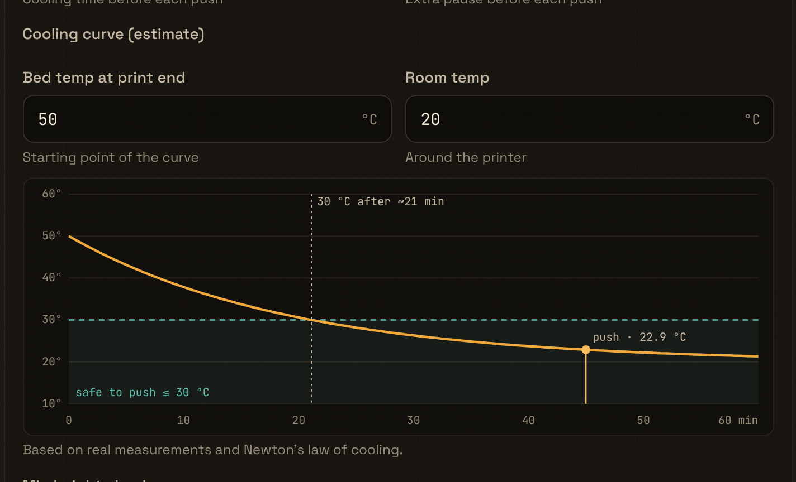

# Configuration

All settings live in the web UI under **Configure the sequence**. Values
outside the allowed range are outlined in red and block the build.

## Settings

| Setting | Default | What it changes |
| --- | --- | --- |
| Prints per plate | `1` | Total copies for that plate. `0` skips it. |
| Push height | `0.4 mm` | Height of the toolhead edge above the plate during the push. |
| Lift height | `5 mm` | Extra clearance above the tallest object before moving. |
| Cooldown | `Fixed time` | *Fixed time* waits a set time before every push and can never stall. *Until temperature* waits (`M190`) until the bed reaches the ejection temperature. |
| Cooldown time | `45 min` | How long the bed cools before every push (fixed-time mode, 1–60 min). |
| Ejection bed temp | `30 °C` | Temperature to wait for (temperature mode). In fixed-time mode the bed target is lowered to it so the heater stays off. |
| Safety wait | `60 s` | Extra dwell after the cooldown, before the push. |
| Min height check | `7 mm` | Rejects plates whose lowest part is too short for a clean push. Heights are measured per object from the gcode. `0` disables the check. |
| Bed temp at print end / room temp | `50 °C` / `20 °C` | Inputs for the cooling curve only; they do not change the gcode. |
| Schedule | `Right away` | Optionally print only inside a daily time window — see [Print window](print-window.md). |

The cooldown and safety wait run **once per object** on the plate, right
before that object is pushed.

> [!TIP]
> G-code cannot say "wait for 30 °C, but at most 5 minutes": `M190` waits
> without a time limit. That is why the default is a **fixed cooldown time**,
> which can never stall. Use *Until temperature* when you need a guaranteed
> bed temperature — but in an enclosed printer or a warm room the bed may never
> get that cool, and the print would wait forever.

Every wait is written as `G4` lines of at most 90 s, because Bambu firmware
caps a single `G4` at 90 s. A 45-minute cooldown is 30 lines of `G4 S90`.

## Cooling curve

  

Under *Safety* the app draws the expected bed temperature after the print:
Newton cooling `T(t) = Ta + (T0 − Ta) · e^(−k·t)` with `k ≈ 0.052 /min`,
fitted to a measured run on a Bambu Lab A1 in a ~20 °C room — a vase still
stuck at 31 °C after 24.5 min, started to lift at 30 °C after 27 min and was
pushed off easily at 28 °C after 34 min.

The green zone is at or below the ejection temperature, the dotted line shows
when the bed reaches it, and the marker shows the predicted temperature at the
push. The app warns when the cooldown is too short. Enclosures, other plates
and warm rooms cool slower — treat the curve as a guide and watch the first
cycle.

## Time estimate

The total time in the app (and in Bambu Studio / Handy for the generated file)
is an estimate: the slicer's print time plus, for every copy, the cooldown,
safety wait and push per object and the re-heat before the next copy. In
*Until temperature* mode a cooldown of 15 minutes per object is assumed.

## Server settings

Upload size, output size, rate limits and memory are set with environment
variables — see the configuration reference in [Public hosting](DEPLOY.md).

---

[← Back to README](../README.md) · [Installation](installation.md) · [Usage](usage.md) · [Configuration](configuration.md) · [Print window](print-window.md) · [Printers](printers.md) · [Safety](safety.md) · [Troubleshooting](troubleshooting.md) · [Development](development.md)
