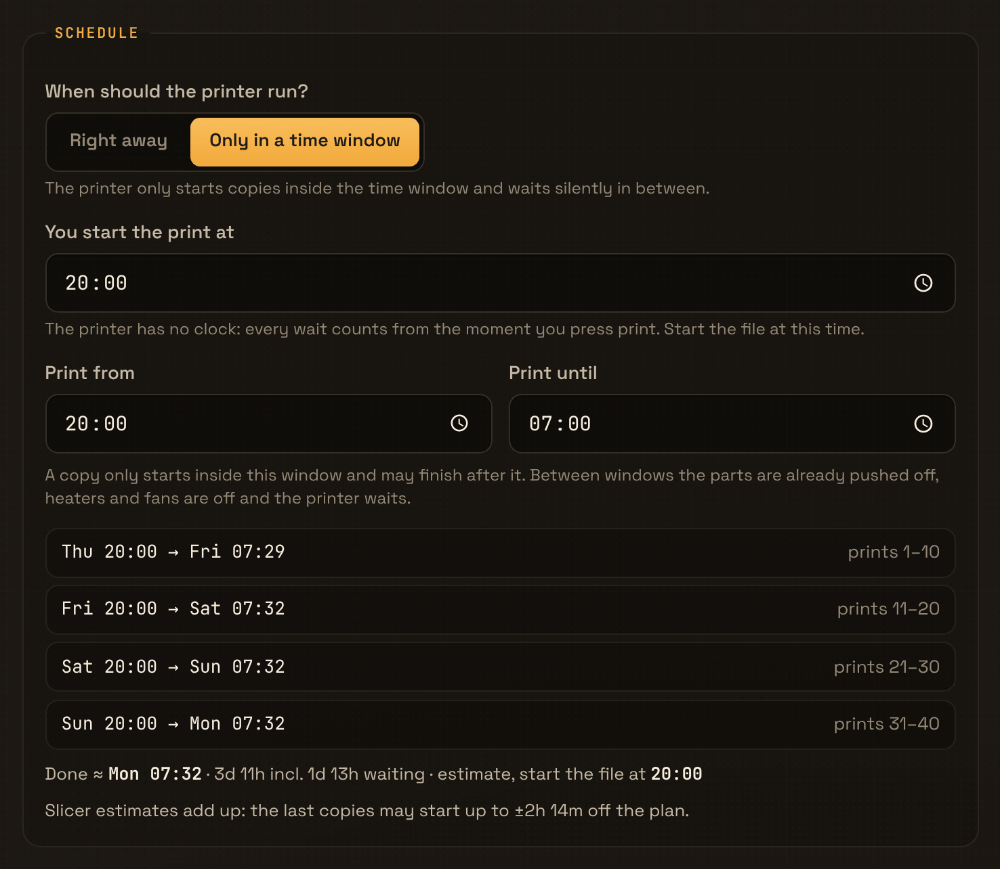

# Print window

Under **Schedule** you can let the printer run only at certain times, for
example overnight. Pick *Only in a time window* and set:

| Setting | Default | Meaning |
| --- | --- | --- |
| You start the print at | `20:00` | When you will press print on the printer. |
| Print from / until | `20:00`–`07:00` | Daily window in which copies may **start**. Windows over midnight work. |

  

  The plan shows which copies run in which window, when the run is done and how far it may drift.

## How it behaves

- A copy only **starts** inside the window and may finish after it. A copy is
  not started in the last 10 minutes of a window.
- When the window is over, the printer waits **after** the part has been
  pushed off: nozzle and bed heaters and the fans are switched off, the file
  waits until the next window opens and then re-heats for the next copy.
- It never pauses mid-print, so no part cools down on the plate.
- Starting before the window opens gives a **delayed start** — press print at
  15:00 and printing begins at 20:00.

> [!IMPORTANT]
> The printer has no clock that G-code can read. The schedule is a timetable
> counted from the moment you press print, so **start the file at the time you
> entered** — the download is named `…_start-2000.gcode.3mf` as a reminder.
> Starting 30 minutes late shifts every window by 30 minutes.

## How the waits are built

- Each wait starts with `M400`, then `M104 S0`, `M140 S0` and `M106 S0` (plus
  `M106 P2 S0` / `P3 S0` on Bambu printers), then a chain of `G4 S90` — Bambu
  firmware caps one `G4` at 90 s.
- The motors stay powered, so the axes do not lose position; every later copy
  runs the start sequence (with homing) again anyway.
- The plan uses the [estimated wall time](configuration.md#time-estimate) of
  every copy. The waits themselves are exact, but slicer estimates drift and
  the drift adds up over many copies. The app shows how far the last copies
  may be off (5 % of the accumulated print time). Long runs over many nights
  get less exact — the printer has no clock to correct this.

## Test it first

Before you rely on it for a multi-night run, try a short window once — the
[printer test protocol](PRINTER_TEST_PROTOCOL.md#6-timing-checks) has a
30-minute test.

---

[← Back to README](../README.md) · [Installation](installation.md) · [Usage](usage.md) · [Configuration](configuration.md) · [Print window](print-window.md) · [Printers](printers.md) · [Safety](safety.md) · [Troubleshooting](troubleshooting.md) · [Development](development.md)
