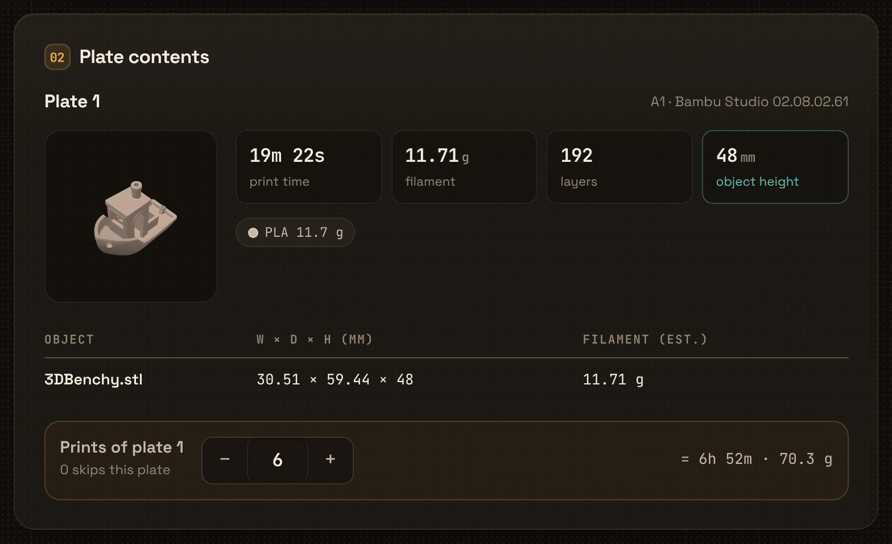
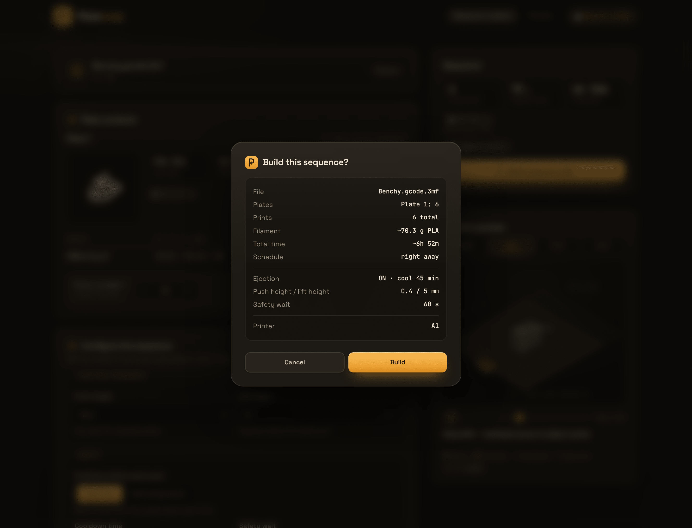
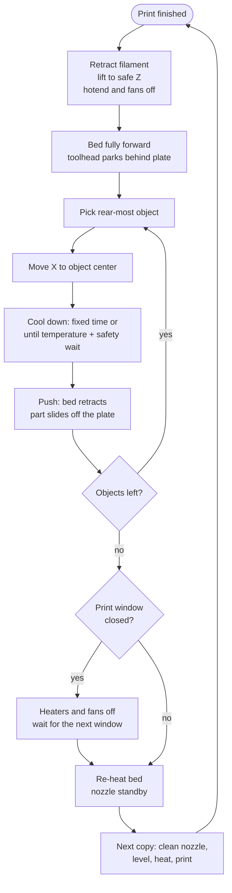

# Usage

## From slicer to printer

1. Slice your part in **Bambu Studio** (Bambu Lab) or **OrcaSlicer** (Bambu
   Lab *and* the other supported vendors). The part must be at least 7 mm
   tall so the toolhead can catch it.
2. Export **File → Export → Plate as .gcode.3mf** — or **All plates as
   .gcode.3mf** for a multi-plate run.
3. Upload the file. Each plate shows print time, filament, layers and its
   **lowest object** — the part that decides whether the push works. It turns
   red when it is below the minimum height.
4. Set the prints per plate with **−/+**. The time and filament for that plate
   update next to it.
5. Adjust the [settings](configuration.md) if needed — values outside the
   allowed range are marked red and block the build. Optionally limit the run
   to a [print window](print-window.md).
6. Check the **ejection preview** on the right. It follows your settings.
7. **Build sequence file**, download the `*_x<N>.gcode.3mf` and print it like
   any other file.

  

  Each plate at a glance. The copies stepper shows what the run will cost in time and filament.

  

  Every build is summarized once more before the file is generated.

## How a run works

  

  Lift → park → cool → push → the part tips over the edge and drops. The preview uses the real object positions from your file.

The generated file is a normal single-plate `.gcode.3mf`: the printer's native
start and end blocks are preserved, and the ejection sequence is inserted
between copies. The motion design is documented in
[ejection logic](ejection_logic.md); the preview frames are validated against
the generated gcode in the test suite.

## Multi-plate files

Export with **All plates as .gcode.3mf** and upload it. Each plate gets its own
preview, object list and **prints** field (`0` = skip). The output is still a
single-plate `.gcode.3mf` whose gcode runs the plates back to back:

- every plate is printed as often as configured,
- every print is followed by that plate's ejection push,
- the first-print purge line runs **once** for the whole sequence,
- nozzle cleaning, homing and leveling still run before every print, and every
  print waits for the print temperature before its first layer,
- the native shutdown runs only after the very last job.

## The download

The file is named after your upload, e.g. `model_x12.gcode.3mf` for 12 total
prints, or `model_x12_start-2000.gcode.3mf` when it is built for a
[print window](print-window.md) starting at 20:00.

---

[← Back to README](../README.md) · [Installation](installation.md) · [Usage](usage.md) · [Configuration](configuration.md) · [Print window](print-window.md) · [Printers](printers.md) · [Safety](safety.md) · [Troubleshooting](troubleshooting.md) · [Development](development.md)
